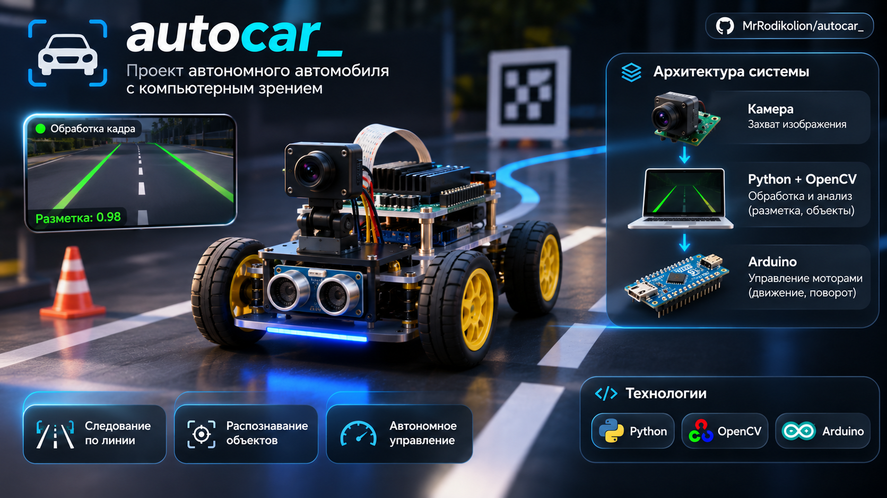
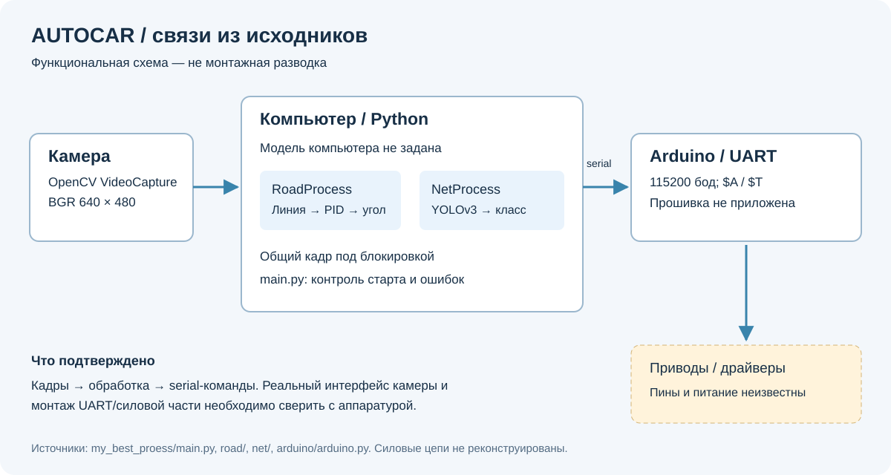

# Autocar — экспериментальная машинка с компьютерным зрением



*Концептуальная иллюстрация: изображение не является точной схемой или подтверждением аппаратной реализации.*

Python-контроллер анализирует дорожную линию и дорожные знаки в отдельных процессах,
а команды руления передаёт Arduino по последовательному порту. Это исследовательский
прототип: камера, веса модели и реальная машинка требуют отдельной проверки.

[Схема устройства](#схема-устройства) · [Запуск](#запуск) · [Протокол](#протокол) · [Проверки](#проверки-и-ограничения)

## Схема устройства



Схема показывает программно подтверждённые связи, а не монтажный чертёж.
Модель компьютера, контакты Arduino, драйверы моторов, питание и тип подключения
камеры в исходниках не определены. Схемы `mahina` или `arduino_mahina` нельзя
автоматически считать схемами этой машинки.

## Компоненты

| Путь | Назначение |
|---|---|
| `my_best_proess/main.py` | Основной диагностический запуск, контроль камеры/процессов, руление |
| `my_best_proess/road/` | Линия, PID и процесс обработки дорожного кадра |
| `my_best_proess/net/` | Экспериментальный YOLOv3 и альтернативный Ultralytics worker |
| `my_best_proess/arduino/` | Команды UART `$A` и `$T` |
| `my_best_proess/with_flask.py` | Старый отдельный эксперимент с Flask и реакциями на знаки |
| `main-dir/`, `tester/` | Исторические варианты, видео и инструменты исследования |

Пути и структура сохранены. Исторические варианты не объявляются готовыми
точками запуска. В основном `main.py` выводится распознанный класс, но автоматические
реакции на знаки не включены: прежде этот участок был недостижим после `continue`.
Парковка и согласование классов с весами остаются незавершёнными.

## Запуск

Нужны Python, NumPy, OpenCV, pyserial, PyTorch; импорт `net` также требует
Ultralytics из-за существующего альтернативного worker. Flask нужен только
отдельному веб-эксперименту. Manifest зависимостей пока отсутствует.

```sh
python -m venv .venv
# Активируйте окружение, затем:
python -m pip install numpy opencv-python pyserial torch ultralytics
python my_best_proess/main.py --help
python my_best_proess/main.py --camera 1
```

Без `--port` вывод UART отключён. Для аппаратного испытания явно задайте порт:

```sh
python my_best_proess/main.py --camera 1 --port /dev/ttyUSB0
# Windows: --port COM5
```

Нужен совместимый YOLO checkpoint по пути `my_best_proess/checkpoint.pth.tar`.
Этого файла в репозитории нет. `main-dir/resnet_prednet.pth` относится к другой
модели и не является заменой. Не загружайте непроверенные PyTorch checkpoints.
Камера должна выдавать BGR-кадры ровно 640×480: алгоритм использует фиксированную
строку 470 и геометрию этой камеры.

При потере кадра, изменении размера, сбое worker или превышении 30 секунд старта
основной процесс завершает работу и освобождает ресурсы. При открытом UART он
пытается отправить `$T0,` перед закрытием. Это не аппаратный watchdog: при обрыве
кабеля доставка остановки не гарантируется.

## Протокол

| Команда | Формат | Проверка отправителя |
|---|---|---|
| Руление | `$A90,` | Конечный числовой угол, ограничение 50…129 |
| Состояние | `$T0,` | Целое значение 0…9 |

Скорость порта — **115200 бод**. После записи ожидается один байт ответа;
его содержание исторический helper не проверяет. Коды состояний и физический
смысл углов нужно сверить с отсутствующей прошивкой, а не угадывать по именам.

## Проверки и ограничения

Внешние проверки проверяют реальные NumPy/OpenCV, поиск линии, PID и UART-формат;
жизненный цикл камеры/worker проверяется с подменёнными устройствами. Камера,
модель, рулевой привод, прошивка и полное автономное движение не проверены.
`--help` не открывает камеру и не требует загрузки тяжёлых библиотек.

Исправлены знаки/нулевой шаг времени PID, границы поиска линии, согласованное
копирование общего кадра, скрывавшиеся ошибки worker, очистка ресурсов и
неограниченное ожидание старта. После изменения интегральной части PID коэффициенты
нужно заново проверить на стенде; численная проверка не подтверждает устойчивость.

## Следующие шаги

- Предоставить совместимые веса и согласовать фактические индексы классов.
- Зафиксировать аппаратную схему, прошивку, питание и команды остановки.
- Добавить watchdog на контроллере и испытать потерю связи.
- Проверить PID и геометрию камеры на неподвижном стенде.
- Отдельно доработать старый `with_flask.py`, прежде чем использовать его с моторами.
- Зафиксировать версии зависимостей и постоянные интеграционные тесты.

Аппаратный релиз не объявлен; схема и документация соответствуют прототипу.
